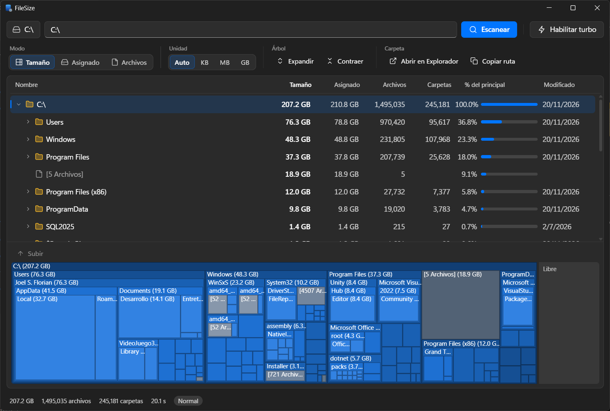
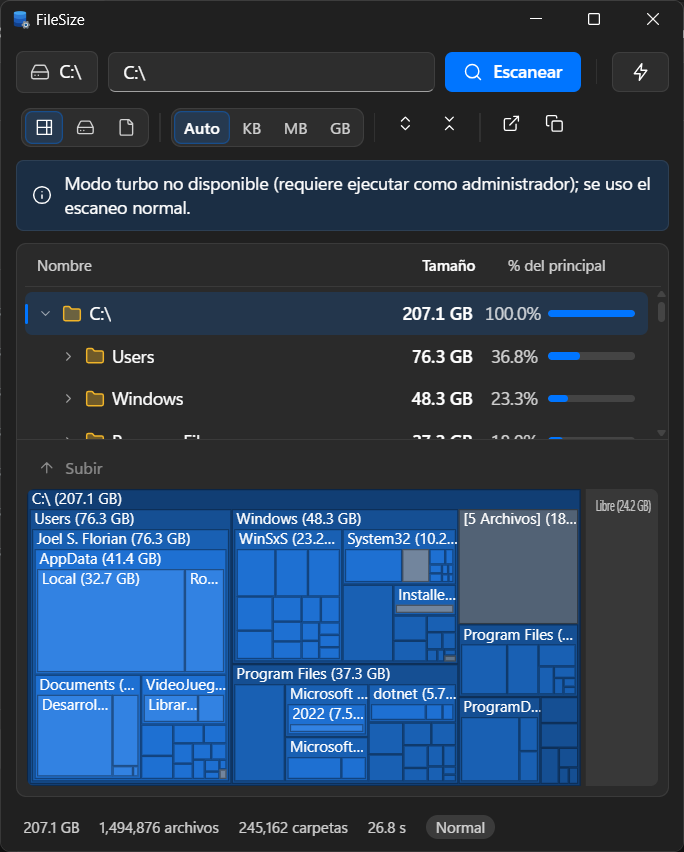
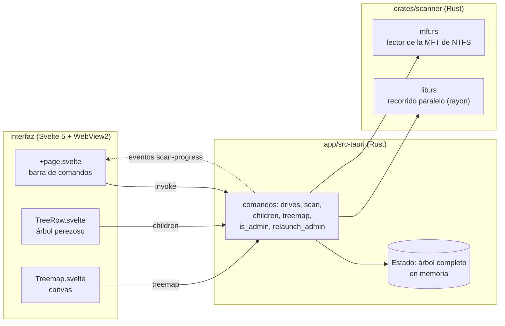

<div align="center">


# FileSize

**Descubre qué se come tu disco. Rápido, ligero y con aspecto de app nativa de Windows 11.**

Analizador de espacio en disco inspirado en TreeSize Free, hecho con **Tauri 2 + Rust + Svelte 5**.

</div>



## Qué hace

- Escanea un disco o carpeta y muestra, para cada carpeta: **tamaño**, **tamaño asignado** (en disco), **archivos**, **carpetas**, **% del principal** y **fecha de modificación**.
- **Mapa de árbol** (treemap) interactivo debajo del árbol: cada rectángulo es una carpeta, anidado por niveles, con el espacio libre del disco al costado.
- **Modo Turbo (MFT)**: lee directamente la Master File Table de NTFS. Escanea `C:` completo en unos **9 segundos** en lugar de ~90 (necesita administrador).
- **Tres modos de vista**: por Tamaño, Asignado o cantidad de Archivos. Cambian la columna resaltada, el orden y el mapa.
- **Unidades** automáticas o fijas (KB, MB, GB).
- **Tema claro y oscuro** que sigue al sistema, con el **color de acento de Windows** y fondo **Mica**.
- **Se compacta** al achicar la ventana: la tabla va soltando columnas y la barra de herramientas pasa a solo iconos.
- Abrir la carpeta en el Explorador, copiar su ruta, expandir y contraer el árbol.

| Compacto (ventana estrecha) |
|---|
|  |

### Atajos de teclado

| Atajo | Acción |
|---|---|
| `F5` | Escanear |
| `Alt` + `↑` | Subir un nivel |
| `Ctrl` + `Mayús` + `C` | Copiar la ruta seleccionada |
| `Enter` / `Espacio` | Expandir o contraer la fila enfocada |

## Peso

| | Tamaño |
|---|---|
| Instalador (NSIS) | ~1.4 MB |
| Ejecutable (`FileSize.exe`) | ~4.4 MB |

Es ligero porque Tauri usa el **WebView2** que ya viene con Windows 11 en vez de empaquetar un navegador (como haría Electron), y porque el backend es Rust sin runtime.

## Rendimiento

Medido en un SSD NVMe con `C:` de ~207 GB y 1.5 millones de archivos:

| Método | Tiempo | Notas |
|---|---|---|
| Escaneo normal (recorrido paralelo) | ~32–89 s | Depende de la caché y del antivirus. No necesita permisos. |
| **Turbo (MFT)** | **~9 s** | Necesita administrador y NTFS. |

Resultado del modo MFT frente a TreeSize Free en el mismo disco: **219.7 GB** contra 217.1 GB (diferencia de ~1 %).

## Cómo está hecho



### Estructura del repositorio

```
FileSize/
├─ crates/scanner/          Motor de escaneo (sin dependencias de UI)
│  ├─ src/lib.rs            Recorrido paralelo con rayon + tipo Node
│  ├─ src/mft.rs            Lectura directa de la MFT de NTFS
│  └─ src/bin/scan.rs       CLI para medir y probar el escáner
├─ app/
│  ├─ src-tauri/            Backend Tauri: comandos, Mica, elevación UAC
│  └─ src/                  Interfaz SvelteKit (SPA, sin SSR)
│     ├─ routes/+page.svelte   Ventana principal, barra de herramientas
│     └─ lib/                  TreeRow, Treemap, Icon, estado y formato
├─ assets/                  Icono original y versión ampliada
└─ docs/                    Capturas de pantalla
```

### El escáner

`scanner::scan` recorre las carpetas con `read_dir` y reparte las subcarpetas entre hilos con **rayon**. Cada nodo (`Node`) guarda tamaño, tamaño asignado, archivos, carpetas, fecha de modificación y los archivos sueltos de esa carpeta. Los **junctions y symlinks se saltan** para no contar dos veces ni caer en bucles, y una carpeta sin permisos se ignora en vez de abortar el escaneo.

El tamaño asignado, en este modo, se aproxima redondeando cada archivo a clusters de 4 KB.

### El modo Turbo (MFT)

En NTFS, todos los archivos del volumen tienen un registro en la **Master File Table**. En lugar de preguntar al sistema de archivos carpeta por carpeta, `mft.rs`:

1. Abre el volumen en crudo (`\\.\C:`) — por eso pide administrador.
2. Lee el sector de arranque: tamaño de cluster, posición de la MFT y tamaño de registro.
3. Lee el registro 0 (`$MFT`) y decodifica su *runlist* para saber en qué clusters vive la tabla.
4. Lee la MFT de corrido en bloques de 16 MB y parsea los registros **en paralelo** con rayon, aplicando los *fixups* de cada sector de 512 B.
5. De cada registro extrae el padre, el nombre (solo de carpetas), el tamaño del `$DATA` y la fecha.
6. Cuenta cada **hardlink** en su carpeta (WinSxS depende de esto) y suma los registros de extensión de archivos muy fragmentados.
7. Arma el árbol a partir de la raíz (registro 5).

Los archivos comprimidos o dispersos usan su tamaño real en disco; los residentes (viven dentro de la MFT) cuentan 0 clusters.

### Árbol perezoso

Un disco tiene cientos de miles de carpetas, así que el árbol completo **nunca viaja a la interfaz**. Vive en memoria en Rust (`AppState`) y la UI pide solo lo que muestra: `children(path)` devuelve las filas de una carpeta y `treemap(path, metric)` devuelve un subárbol recortado (4 niveles, 40 hijos por carpeta, sin rectángulos diminutos). Las rutas son listas de índices desde la raíz.

### El mapa de árbol

`Treemap.svelte` implementa el algoritmo **squarified** (Bruls et al.) a mano, sin librerías, y lo dibuja en un `<canvas>` a la resolución real de la pantalla. Los tonos salen del **color de acento del sistema** (se lee `AccentColor` desde CSS y se convierte a HSL) y se repinta si cambia el tema.

### Aspecto nativo de Windows 11

- **Mica**: la ventana es transparente y el backend aplica el material con [`window-vibrancy`](https://crates.io/crates/window-vibrancy).
- **Tema**: todo el color son variables CSS con `prefers-color-scheme`; el acento usa `AccentColor`.
- **Tipografía**: Segoe UI Variable.
- **Componentes** al estilo Fluent: interruptor, control segmentado, barra de comandos, selección con indicador lateral.
- **Compactado**: la tabla usa *container queries* sobre su tarjeta y pierde columnas por orden de importancia (Modificado → Carpetas → Asignado y Archivos). Por debajo de 860 px los botones quedan solo con icono.

## Requisitos para compilar

- Windows 10/11 x64 con **WebView2** (viene en Windows 11).
- [Rust](https://rustup.rs) estable y las *Build Tools* de Visual Studio (C++).
- [Node.js](https://nodejs.org) 20 o superior.

## Uso

```powershell
cd app
npm install
npm run tauri dev        # desarrollo con recarga en caliente
npm run tauri build      # genera el instalador en target\release\bundle\nsis
```

Para probar el **Turbo** en desarrollo, abre la terminal **como administrador** y ejecuta `npm run tauri dev` desde ahí. En la versión instalada, el botón *Habilitar turbo* relanza la app pidiendo elevación (UAC).

### Escáner por línea de comandos

```powershell
cargo run --release -p scanner --bin scan -- "C:\Users"          # escaneo normal
cargo run --release -p scanner --bin scan -- --mft C:\           # modo MFT (administrador)
cargo test -p scanner                                            # pruebas
```

## Límites conocidos

- El instalador **no está firmado**, así que SmartScreen puede avisar al ejecutarlo.
- En escaneo normal el tamaño asignado es una aproximación (clusters de 4 KB).
- En modo MFT quedan ~1 % de archivos de diferencia frente a TreeSize (nombres guardados en registros de extensión).
- Solo el modo MFT exige NTFS; en otros sistemas de archivos se usa el escaneo normal.
- No se puede cancelar un escaneo en curso ni escanear varias carpetas a la vez.
- Una carpeta con miles de hijos pinta todas sus filas (aún sin virtualización).

## Hoja de ruta

- Cancelar escaneo y reescanear solo la carpeta seleccionada.
- Virtualizar la lista de filas.
- Búsqueda por nombre y filtros por tamaño o fecha.
- Exportar a CSV.
- Firmar el instalador.

## Créditos y aviso

- Icono de [Icons8](https://icons8.com) (*Windows 11 Color – Data Configuration*).
- FileSize es un proyecto independiente **inspirado en TreeSize Free**; no está afiliado a JAM Software ni usa su código.
